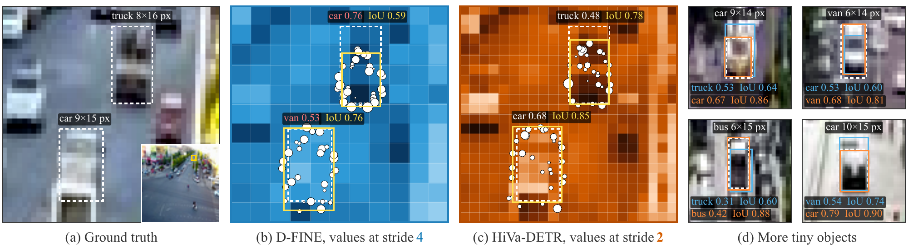
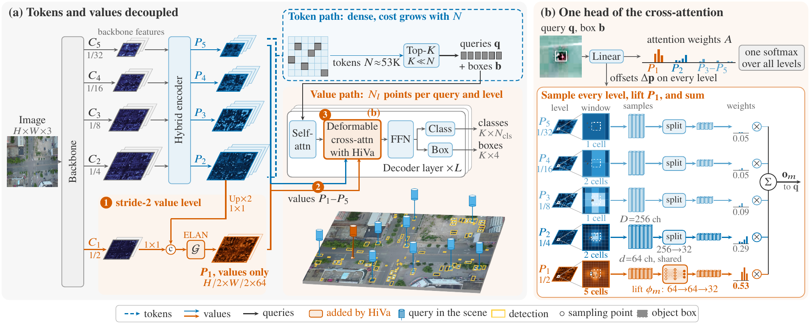

# HiVa-DETR

Official code and checkpoints of **Fine Values, Coarse Tokens: High-Resolution Value Sampling for Detecting Tiny Objects with DETRs**.

<p align="center">
  
</p>
<p align="center"><em>Values at stride 2 instead of stride 4 improve both the localization and the classification of tiny objects (D-FINE vs. HiVa-DETR on VisDrone).</em></p>

The sampling points of a decoder head on a tiny object tend to fall within a single cell of the finest pyramid level of a DETR, so the head reads nearly identical features at all of its points.
We term this sampling collapse.
High-Resolution Value Sampling (HiVa) alleviates it by decoupling the resolution of the values from that of the tokens.
It builds a lightweight stride-2 level P1 from the backbone's stem feature and P2, and feeds P1 to the decoder solely as values.
Every decoder layer samples P1 jointly with P2 to P5 in its deformable cross-attention, while the encoder and the query selection keep their tokens unchanged.
This costs about one twentieth of adding P1 as tokens.
HiVa-DETR applies HiVa to D-FINE.

<p align="center">
  
</p>
<p align="center"><em>Architecture of HiVa, which decouples the resolution of the values from that of the tokens. All feature maps (channel norms), detections, queries, and sampling points come from the trained HiVa-DETR-S on one VisDrone image. (a) Tokens and values decoupled, in D-FINE with HiVa, whose parts are drawn in vermilion and numbered. HiVa (1) builds the stride-2 level P1 from the stem feature and P2, (2) feeds P1 to the decoder solely as values, and (3) samples it jointly with P2 to P5 in the deformable cross-attention detailed in (b). The scene in the value path marks in vermilion the query of a motorcycle of 10 pixels. (b) One head of this cross-attention, which lifts its samples of P1 to the channels of the head. Its output updates the query, from which each decoder layer predicts both the classes and the boxes. For the motorcycle, the points of this head fall into at most two cells of P2 to P5 but five cells of P1.</em></p>

This repository currently contains the inference and evaluation code and the trained checkpoints.
The training code will be released upon acceptance of the paper.

## Results and checkpoints

**VisDrone2019-DET** (validation, 800 x 800)

| Model | Params (M) | GFLOPs | AP | AP50 | AP75 | APs | APm | APl | Checkpoint |
|---|---|---|---|---|---|---|---|---|---|
| HiVa-DETR-S | 12.0 | 130.3 | 37.6 | 59.9 | 39.5 | 30.2 | 47.4 | 61.4 | [hiva_detr_s_visdrone.pth](https://github.com/shijie-research/HiVa-DETR/releases/download/v1.0/hiva_detr_s_visdrone.pth) |
| HiVa-DETR-M | 22.8 | 263.9 | 39.7 | 62.8 | 41.4 | 32.4 | 49.5 | 63.4 | [hiva_detr_m_visdrone.pth](https://github.com/shijie-research/HiVa-DETR/releases/download/v1.0/hiva_detr_m_visdrone.pth) |
| HiVa-DETR-L | 35.2 | 349.5 | 39.9 | 63.1 | 42.1 | 32.5 | 49.9 | 61.5 | [hiva_detr_l_visdrone.pth](https://github.com/shijie-research/HiVa-DETR/releases/download/v1.0/hiva_detr_l_visdrone.pth) |

**AI-TOD-v2** (test)

| Model | Params (M) | GFLOPs | AP | AP50 | AP75 | APvt | APt | APs | APm | Checkpoint |
|---|---|---|---|---|---|---|---|---|---|---|
| HiVa-DETR-S | 12.0 | 128.0* | 32.8 | 67.8 | 27.9 | 17.1 | 32.5 | 39.5 | 46.5 | [hiva_detr_s_aitod.pth](https://github.com/shijie-research/HiVa-DETR/releases/download/v1.0/hiva_detr_s_aitod.pth) |
| HiVa-DETR-M | 22.8 | 260.6* | 33.9 | 67.7 | 29.8 | 17.1 | 34.0 | 39.5 | 47.9 | [hiva_detr_m_aitod.pth](https://github.com/shijie-research/HiVa-DETR/releases/download/v1.0/hiva_detr_m_aitod.pth) |
| HiVa-DETR-L | 35.2 | 344.8* | 34.7 | 69.4 | 30.4 | 18.7 | 34.7 | 39.6 | 49.3 | [hiva_detr_l_aitod.pth](https://github.com/shijie-research/HiVa-DETR/releases/download/v1.0/hiva_detr_l_aitod.pth) |

\* Averaged over the test split, as the number of queries varies per image.

**TinyPerson** (test, AP50)

| Model | tiny1 | tiny2 | tiny3 | tiny | small | Checkpoint |
|---|---|---|---|---|---|---|
| HiVa-DETR-S | 46.15 | 61.02 | 65.77 | 57.68 | 68.26 | [hiva_detr_s_tinyperson.pth](https://github.com/shijie-research/HiVa-DETR/releases/download/v1.0/hiva_detr_s_tinyperson.pth) |

Results may differ in the last digit on other GPUs.

## Installation

Python 3.10 or later.

```bash
pip install -r requirements.txt
```

## Data

The datasets are read from the Hugging Face Hub and downloaded on first use.

| Dataset | Hub repository |
|---|---|
| VisDrone2019-DET | [shijli/visdrone2019-det](https://huggingface.co/datasets/shijli/visdrone2019-det) |
| AI-TOD-v2 | [shijli/aitod-v2](https://huggingface.co/datasets/shijli/aitod-v2) |
| TinyPerson | [shijli/tinyperson](https://huggingface.co/datasets/shijli/tinyperson) |

AI-TOD-v2 and TinyPerson are gated.
Accept their terms on the Hub and log in with `huggingface-cli login` before the first run.

## Evaluation

Download a checkpoint into `weights/` and run

```bash
python test.py -c configs/HiVa-DETR-S-VisDrone.yml -r weights/hiva_detr_s_visdrone.pth
python test.py -c configs/HiVa-DETR-S-AITOD.yml -r weights/hiva_detr_s_aitod.pth
python test.py -c configs/HiVa-DETR-S-TinyPerson.yml -r weights/hiva_detr_s_tinyperson.pth
```

Config entries can be overridden on the command line, e.g. `-u val_dataloader.total_batch_size=8 val_dataloader.num_workers=2`.

## AI assistance

The research idea, the method and the design of the experiments are the authors' own.
The code was written, refactored and organized with [Claude Code](https://claude.com/claude-code) (Anthropic's Claude Opus models) under the authors' direction.
The authors reviewed the code and checked the released checkpoints against the reported results.

## Acknowledgments

This code is built on [D-FINE](https://github.com/Peterande/D-FINE), [RT-DETR](https://github.com/lyuwenyu/RT-DETR) and [Dome-DETR](https://github.com/RicePasteM/Dome-DETR).
The TinyPerson evaluation follows [TinyBenchmark](https://github.com/ucas-vg/TinyBenchmark).

## License

Apache License 2.0. See [LICENSE](LICENSE).
